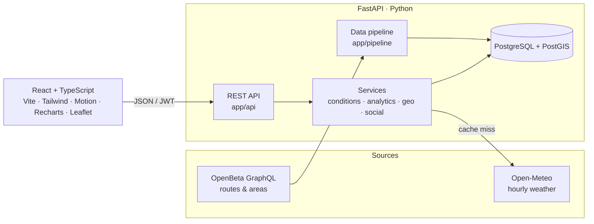

# Crux

**Data-driven climbing conditions, route finder, logbook and partner finder.**

Crux answers the question every climber asks: *is it good out there?* It combines live weather, sun angle and rock-type drying rules into a 0–100 **Conditions Score** for 800+ crags, then helps you log the send, track your progression, and find someone to climb with.

> **Live demo:** _add your Vercel URL here_. Click **Try the live demo** to explore a fully populated account, no signup needed.

## Features

| | |
|---|---|
| **Conditions Score** | Hour-by-hour 0–100 rating per crag for the next 72 hours, with plain-language reasons ("Prime friction temps", "Sandstone still wet"), best climbing windows and a daily outlook. |
| **Route finder & map** | ~17,000 real routes and boulder problems from OpenBeta across 22 destinations. Filter by grade, style and area on an interactive map. |
| **Logbook** | Log outdoor sends or gym climbs: onsight / flash / redpoint / attempts, star ratings and notes. |
| **Progression analytics** | Grade pyramids (by send style), monthly send trends with hardest-grade line, style breakdown, weekly streaks and personal bests. |
| **Friends & activity feed** | Friend requests, a feed of your crew's sends and partner posts, and kudos. |
| **Partner finder** | Post when and where you want to climb (gym or crag) and find posts near you with PostGIS distance search. |
| **Crowdsourced wall aspect** | Climbers set which way a wall faces, which makes the sun/shade model precise for that crag. |

## How the Conditions Score works

`backend/app/services/conditions.py`

1. **Weather pipeline.** Open-Meteo hourly forecasts (temperature, humidity, rain, wind, cloud, direct radiation), including the **past 48 hours** of rain. Fetched in one batched request for many areas and cached in PostgreSQL with a 1-hour TTL.
2. **Sun & shade.** Solar elevation and azimuth computed each hour with NOAA's solar position equations (`services/sun.py`). If a wall's aspect is known, Crux knows whether it's in direct sun, which raises rock temperature and speeds drying.
3. **Rock-type drying model.** Rain adds water to the rock. Sun, wind, warmth and dry air remove it at a rate specific to each rock type (granite dries in ~4h, sandstone needs ~36h). Limestone and conglomerate model **seepage** after heavy rain. **Wet sandstone is capped at "No-go"** because climbing it breaks holds.
4. **Scoring.** Rock temperature against the 7–13°C friction sweet spot, plus humidity, wind and rain probability, blended and then capped by wetness and active rain.

## Architecture



- **Layered backend:** routes handle HTTP, services hold the logic, SQLAlchemy models map tables, and Pydantic schemas define the API's JSON.
- **Geospatial:** "near me" queries use PostGIS `ST_DWithin` on GiST expression indexes. Local dev and tests fall back to SQLite with a haversine function, so you need no database install to run it.
- **Auth:** bcrypt password hashing and JWT bearer tokens.
- **Migrations:** Alembic.
- **Tests:** pytest suite covering grade parsing, solar math, the scoring model and every API flow.

## Tech stack

**Backend:** Python 3.12+, FastAPI, SQLAlchemy 2, Alembic, PostgreSQL/PostGIS, Pydantic v2, httpx, pytest, ruff
**Frontend:** React 19, TypeScript (strict), Vite, Tailwind CSS v4, Motion (animations), Recharts, React Leaflet, React Router
**Infra:** Vercel (frontend + serverless FastAPI), Neon Postgres

## Run it locally

You need Python 3.12+ and Node 20+. No database is needed: it uses SQLite by default.

```bash
# Backend: http://localhost:8000 (API docs at /docs)
cd backend
python3 -m venv .venv && source .venv/bin/activate
pip install -r requirements-dev.txt
alembic upgrade head            # create tables
python -m app.pipeline.seed     # load 17k routes + demo climbers
uvicorn app.main:app --reload
```

```bash
# Frontend: http://localhost:5173
cd frontend
npm install
npm run dev
```

```bash
# Tests and lint
cd backend && pytest && ruff check .
cd frontend && npm run build && npm run lint
```

Refresh route data from OpenBeta (optional, since the snapshot is committed): `python -m app.pipeline.openbeta`

## Deploy (Vercel + Neon)

The repo deploys as **two Vercel projects** from one GitHub repository:

| Project | Root directory | Environment variables |
|---|---|---|
| `crux-api` | `backend` | `DATABASE_URL` (Neon, pooled), `SECRET_KEY`, `FRONTEND_ORIGIN` = the web URL |
| `crux-web` | `frontend` | `VITE_API_URL` = the API URL |

Create the database tables and data once, from your machine:

```bash
cd backend
DATABASE_URL="postgresql://…neon.tech/neondb?sslmode=require" alembic upgrade head
DATABASE_URL="postgresql://…neon.tech/neondb?sslmode=require" python -m app.pipeline.seed
```

## Project structure

```
backend/
  app/
    api/routes/   HTTP endpoints: auth, places, logbook, social, partners
    core/         settings (env vars), password hashing + JWT
    db/           engine, sessions, declarative base
    models/       SQLAlchemy tables
    schemas/      Pydantic request/response models
    services/     conditions score, sun position, weather cache, grades, analytics, geo, social
    pipeline/     OpenBeta importer, curated destinations, seed script
  alembic/        migrations
  data/           committed OpenBeta snapshot
  tests/
frontend/
  src/
    api/          typed fetch client
    components/   UI kit, animated topo background, score ring, charts, map, modals
    hooks/        auth, data loading, geolocation, units
    pages/        landing, explore, area, crag, routes, logbook, progress, feed, partners, people, profile
    types/        TypeScript mirrors of the API schemas
```

## Data & credits

Route data from [OpenBeta](https://openbeta.io) (open climbing data). Weather from [Open-Meteo](https://open-meteo.com). Map tiles © Esri and [OpenStreetMap](https://www.openstreetmap.org/copyright) contributors. Demo users are fictional.
